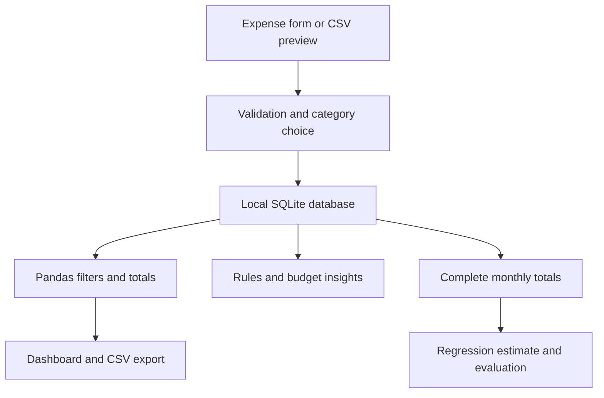

# Smart Expense Tracker with AI Insights

A beginner-friendly Python application for recording INR expenses, visualizing spending, suggesting expense categories, and estimating next month's spending. Built with **Streamlit, Pandas, NumPy, scikit-learn, Plotly, and SQLite**. It runs locally; no paid API, external LLM, bank connection, React, Node.js, or separate backend is needed.

**Honest scope:** this is a single-user learning/portfolio project. Category training data and all committed transactions are synthetic. Budget suggestions and unusual-amount flags are rules; only categorization and forecasting are machine learning. It does not connect to banks or provide continuous transaction ingestion.

## Implemented features

- Add, view, edit, and delete expenses; validate date, description, positive INR amount, and supported category.
- Eight categories: Food, Transport, Shopping, Bills, Entertainment, Health, Education, Other.
- Persistent SQLite storage, integer paise for amounts, parameterized queries, and atomic CSV imports.
- Downloadable CSV template, row validation, preview, duplicate flags, explicit valid-row import confirmation, and filtered CSV export.
- Dashboard date/category filters, literal text search, total/current-month/daily-average metrics, top category, and interactive monthly, category, and daily charts.
- TF-IDF + Logistic Regression category suggestions with manual overrides, category-source labels, and measured synthetic classification metrics.
- Linear Regression next-month estimates with chronological two-step evaluation and a last-observed-month baseline.
- Saved monthly budget, usage/overspending, matched-period comparison, largest category, IQR outlier flags, and data-grounded suggestions.
- Isolated personal and synthetic demo databases. Generate 30 complete months of reproducible demo transactions.
- Graceful empty data, insufficient training data, unknown vocabulary, and insufficient forecast history handling.

## Stack and purpose

| Technology | Purpose |
|---|---|
| Python | Application logic and built-in `sqlite3` storage access |
| Streamlit | Forms, tabs, validation feedback, cached reads, automatic reruns |
| Pandas | Date parsing, filters, grouped totals, rolling features, CSV exports |
| NumPy | Reproducible synthetic variation and numerical calculations |
| scikit-learn | TF-IDF pipeline, classifiers, regression, evaluation metrics |
| Plotly | Interactive bar, donut, and line charts |
| SQLite | Local persistent transactions and budget settings |
| pytest / Streamlit AppTest | Data/model tests and actual UI interaction tests |

## Project structure

```text
smart-expense-tracker/
├── app.py                     # Streamlit interface
├── database.py                # SQLite CRUD and saved budget
├── data_processing.py         # Validation, CSV, filtering, metrics
├── ml_models.py               # Classifier and leakage-safe forecast
├── insights.py                # Rule-based calculations
├── generate_sample_data.py    # Deterministic synthetic generators
├── evaluate_models.py         # Reproduce reported ML measurements
├── requirements.txt           # Tested direct dependency versions
├── README.md
├── .gitignore
├── data/
│   ├── sample_expenses.csv    # 1,057 synthetic transactions
│   └── category_training.csv  # 288 labeled synthetic descriptions
└── tests/
    ├── test_core.py
    └── test_app.py
```

The application creates `local_data/personal.sqlite3` and `local_data/demo.sqlite3` automatically. These are ignored by Git. `EXPENSE_TRACKER_DATA_DIR` optionally changes their location (also used for isolated tests).

## Windows setup in VS Code

Install **Python 3.12** and Git. Select Python 3.12 in VS Code. These direct dependency versions were tested on Python 3.12.14 in Linux; Windows commands are provided but Windows execution was not available for verification.

In a VS Code **Command Prompt** terminal:

```bat
git clone https://github.com/sourav7798/smart-expense-tracker.git
cd smart-expense-tracker
py -3.12 -m venv .venv
.venv\Scripts\activate.bat
python -m pip install --upgrade pip
python -m pip install -r requirements.txt
streamlit run app.py
```

Open the local address printed by Streamlit (normally `http://localhost:8501`). Use `Ctrl+C` to stop. Expenses remain saved after restart. Run all commands from the project directory.

For **PowerShell**, activate with:

```powershell
.\.venv\Scripts\Activate.ps1
```

If your execution policy blocks activation, use the interpreter directly without changing system policy:

```powershell
.\.venv\Scripts\python.exe -m pip install -r requirements.txt
.\.venv\Scripts\python.exe -m streamlit run app.py
```

Run validation and reproduce the model measurements:

```bat
python -m pytest -q
python evaluate_models.py
```

## Try the application

1. Select **Synthetic demo** in the sidebar.
2. Click **Load synthetic demo data**. The generator uses seed 42 and 30 complete months ending last month, relative to your machine's date. Repeated loads in the same month skip exact duplicates.
3. Explore Dashboard charts and search. Go to Insights & forecast for the forecast and rules.
4. Select **Personal** to enter your own expenses. Demo expenses never enter the personal database.
5. In Manage expenses, type a description, review the suggestion, enter a positive amount, choose a category or use the suggestion, and save.
6. To edit, select the transaction ID, change values, and save. Saving marks the category as manually reviewed. Deletion needs the checkbox confirmation.
7. Set a monthly budget in Insights & forecast; 0 disables budgeting. The saved target applies to each calendar month, rather than maintaining a separate budget history.

The dashboard refreshes after app changes without restarting the server. Reads are cached for up to 60 seconds, cleared immediately after writes, and can be cleared with **Refresh data**. External database changes may take up to the cache TTL to appear. The classifier cache is keyed by the training file contents.

The fixed committed expense sample covers **April 2024–September 2026**. Recreate the exact committed data with:

```bat
python generate_sample_data.py --as-of 2026-10-01
```

This generates the two synthetic CSVs only, never edits a database. To shift the files to another date, pass that date to `--as-of`; the live demo button already uses today's date. A reload in a later calendar month can add another synthetic history to existing demo data: for a fresh demo, stop the app and remove **only** `local_data/demo.sqlite3` before reloading. Do not delete the personal database.

## CSV format and validation

```csv
date,description,amount,category
2026-01-15,Metro ticket,60.00,Transport
2026-01-16,Cafe coffee,120.50,Food
2026-01-17,Doctor consultation,700.00,
```

- Required headers: `date`, `description`, `amount`. `category` is optional, including the entire column.
- UTF-8 or UTF-8 with BOM, comma delimiter, standard CSV quoting. Quote descriptions containing commas.
- Dates must be exact `YYYY-MM-DD`, real dates, and not in the future. Refunds and planned future payments are outside this expense-only app.
- Descriptions must contain 1–300 characters after trimming.
- Amount must be finite, greater than zero, no more than INR 1 billion, and have at most two decimal places. Use `1200.50`, not currency symbols or comma-separated numbers.
- Supplied categories must match one of the eight names. Missing categories receive a model suggestion or an `Other` fallback.
- Wrong field counts, empty rows, invalid values, unknown/duplicate headers, and broken quotes receive validation feedback. Structural parsing failure rejects the entire file; other bad rows are excluded from the valid preview.
- Upload limit: 5 MB, an application guardrail, not a measured capacity claim.
- Nothing is saved until **Import reviewed rows**. When errors exist, explicitly confirm importing only valid rows.
- Exact transaction duplicates mean equal ISO date, trimmed case-sensitive description, and integer paise. Category/source are ignored so recategorization cannot hide duplicate purchases. Duplicate checks include existing data and earlier rows in the same file.
- **Skip duplicates** defaults on; turn it off to deliberately keep repetitions. Import rechecks duplicates under a SQLite transaction.
- Review predictions in the preview; override them afterward using Manage expenses. The table retains `manual`, `model`, `fallback`, or `synthetic` category source.
- Export contains `date,description,amount,category` for the currently filtered and searched dashboard. Source metadata remains in SQLite. Free-text descriptions starting with spreadsheet formula characters are prefixed with an apostrophe for safer spreadsheet opening; those special descriptions will not round-trip byte-for-byte.

## How data moves



Data is saved with parameterized SQL. After a write, the read cache is cleared and Streamlit reruns. The sidebar selects which database the entire app uses. Dashboard filters apply to dashboard metrics, charts, table, and export; insights and forecasts deliberately use all records in that mode.

Current-month dashboard spending is the current month **within the selected filters**. Daily average is filtered spending divided by every calendar day in the selected inclusive range, including days with no purchases. This is not average per active purchase day.

## How machine learning works

### Category classifier

`category_training.csv` contains 288 synthetic descriptions: 36 distinct descriptions for each category. Labels are explicitly assigned by the generator, not inferred from real customer records. Descriptions use 12 category-specific phrases with three context variations.

1. Normalize case/whitespace; remove conflicting labels and duplicate normalized descriptions.
2. Require all eight categories, at least four unique descriptions per category, and at least 40 total.
3. Use a stratified 75/25 split with seed 42, preserving class proportions.
4. Fit a `Pipeline(TfidfVectorizer(ngram_range=(1,2)), LogisticRegression(...))` on the training partition only.
5. Measure accuracy and per-class precision, recall, F1, and support on the held-out test partition.
6. Use that same evaluated training-only pipeline for suggestions. Manual overrides are stored but do not automatically retrain it.

TF-IDF converts words/word pairs into numeric features; Logistic Regression learns weights connecting those features to categories. Unknown vocabulary or unavailable training yields `Other` with source `fallback`. Predictions are suggestions, not guarantees. There is no external language model.

**Synthetic templates share vocabulary even after exact deduplication. This makes evaluation easier than real bank descriptions; the score is not real-world accuracy.** Real deployment would require representative consented labels and merchant/template-grouped evaluation.

### Next-month forecast

- Aggregate spending by calendar month. Always discard the first recorded month because its coverage may be incomplete; also discard the incomplete current month and future records.
- Fill gaps in the intervening month sequence with zero **only under the assumption that the imported history is complete**. Personal mode asks you to confirm that coverage. An unimported month must not be interpreted as no spending.
- Require **15 usable complete months after exclusions**. Usually this requires records spanning at least 16 completed calendar months. Otherwise show **Not enough historical data**.
- For target month `t`, use `spending[t-1]` and the mean of `spending[t-3:t]` (the previous three months). Implementation shifts by one before rolling; the target is never a feature.
- Train a simple Linear Regression. Since the current month is incomplete, first predict its total, then recursively predict next month using that estimated current total. No partial current-month transaction is used.
- Evaluate the last three historical target months in chronological expanding windows. For each target, training ends two months before the target; the intervening month is predicted, not read. Earlier test months may become history for later origins, just as in real use.
- Compare against a persistence baseline that predicts the previous observed month's spending and repeats it for the second step. With this two-step horizon, that last observed month is two calendar months before the target. Neither method sees the intervening month's actual amount.
- Report MAE in INR for the same targets/horizon. Refit on all usable completed history for the live estimate. Clip negative predictions to zero in both evaluation and live predictions.

This small linear model does not explicitly model holidays, seasonality, income changes, or category-level behavior. Three evaluation targets provide weak evidence. MAE is an error summary, not an uncertainty interval. The app also shows the baseline estimate and warns when it outperforms the model.

### Rule-based insights

These are **not trained AI**:

- Largest category: maximum all-history category sum.
- Budget usage: current-month spending ÷ saved budget × 100. Overspending: positive difference from budget. Zero budget disables percentages/alerts.
- Matched-period comparison: compare the same first `N` days of current and previous month, where `N` is limited by the previous month's length. For March 31 versus February, compare March 1–28 and February 1–28 (or 29 in a leap year). Budget still counts all current-month days.
- Percentage change is unavailable if the previous matched period has no recorded spending; missing history can distort comparisons.
- Unusually large transaction: with at least eight records, flag `amount > Q3 + 1.5 × (Q3 − Q1)` over all recorded expenses. This is an IQR rule, not fraud detection. Ordinary rent can be flagged.
- Suggestions refer to actual largest categories, measured increases, and remaining/exceeded budget; there is no generated financial advice from an LLM.

## Measured evaluation and verification

Measured on Python **3.12.14**, Streamlit **1.65.0**, Pandas **2.2.3**, NumPy **2.3.5**, scikit-learn **1.8.0**, Plotly **6.9.0**, pytest **9.1.1**. Direct versions are pinned; transitive dependencies may still vary.

Reproduce with `python evaluate_models.py`, which uses committed synthetic CSVs and fixed forecast reference date **2026-10-12**. The live app uses today's date, so live values can differ.

| Synthetic classifier measure | Measured result |
|---|---:|
| Training / held-out descriptions | 216 / 72 |
| Accuracy | 88.89% |
| Macro precision | 0.9040 |
| Macro recall | 0.8889 |
| Macro F1 | 0.8847 |

| Category | Precision | Recall | F1 | Test support |
|---|---:|---:|---:|---:|
| Bills | 1.0000 | 1.0000 | 1.0000 | 9 |
| Education | 0.7778 | 0.7778 | 0.7778 | 9 |
| Entertainment | 1.0000 | 1.0000 | 1.0000 | 9 |
| Food | 1.0000 | 0.6667 | 0.8000 | 9 |
| Health | 0.8182 | 1.0000 | 0.9000 | 9 |
| Other | 0.8182 | 1.0000 | 0.9000 | 9 |
| Shopping | 0.8182 | 1.0000 | 0.9000 | 9 |
| Transport | 1.0000 | 0.6667 | 0.8000 | 9 |

| Forecast measure | Measured result |
|---|---:|
| Usable complete historical months | 29 |
| Held-out target months | July–September 2026 |
| Linear Regression two-step MAE | INR 8,691.05 |
| Persistence baseline two-step MAE | INR 8,826.32 |
| November 2026 model estimate | INR 40,043.57 |

The small measured improvement over baseline does not demonstrate reliable real-world forecasting. The estimate and errors above are synthetic demonstration results, not personal predictions.

Tests cover invalid dates/amounts/fields, malformed CSV, duplicates within uploads and existing records, atomic imports, persistence, SQL-like descriptions, budget arithmetic, unequal month lengths, outlier thresholds, filters/metrics, target/future leakage, recursive horizon, incomplete-month exclusion, negative predictions, insufficient training/history, deduplicated classification splits, reproducible samples, and spreadsheet-safe export. Streamlit AppTest exercises add/edit/delete, saved budget alerts, database isolation, demo loading, chart/model execution, and a fresh session.

**Verification completed:** `python -m pytest -q` passed **31 tests**; Python compilation and `git diff --check` passed. A real headless Streamlit server returned HTTP 200 for both `/_stcore/health` (`ok`) and `/`. UI interaction checks used Streamlit AppTest, not manual browser testing. Windows execution was not tested.

No large-dataset benchmark or performance improvement was measured; no such claim is made. Cached reads and vectorized Pandas operations are implementation choices, not proof of scalability.

## Limitations and troubleshooting

- Local single-user app; no login, encryption at rest, bank sync, currency conversion, refunds, recurring-payment scheduler, or cloud backup.
- Protect/back up your own local SQLite file. Public hosting would need authentication, separate user storage, and a security review.
- Missing records affect totals and forecasting. The history-coverage checkbox is a user assertion, not an automatic proof.
- Synthetic descriptions and transactions simplify both models. Manual categories are easy to review but are not online learning.
- No measured large-dataset support; the UI loads the local table into memory.
- **`python`/`py` not found:** install Python 3.12, enable Add Python to PATH, restart VS Code; try `py -3.12 --version`.
- **Module not found:** select `.venv\Scripts\python.exe` in VS Code and install dependencies through that same interpreter.
- **`streamlit` not recognized:** use `python -m streamlit run app.py` inside the activated environment.
- **PowerShell activation blocked:** use the explicit `.venv` interpreter commands above.
- **Port busy:** `python -m streamlit run app.py --server.port 8502`.
- **No expenses/charts:** add a record or select Synthetic demo and click its load button; clear restrictive filters and search.
- **Not enough historical data:** at least 15 usable complete months are required; adding many rows in one month does not satisfy that requirement.
- **CSV errors:** use the template, UTF-8, exact ISO dates, numeric positive amounts, and supported category spelling. Fix errors or explicitly import only valid rows.
- **Database locked:** close other copies of the app or tools writing to the same database and retry. Do not remove a database containing your data.
- **Training file missing:** run `python generate_sample_data.py`; manual categories remain usable without a classifier.

## Git commands for a new empty repository

For a separate new empty GitHub repository, replace the placeholders first:

```bat
git init
git add .
git status
git commit -m "Build Smart Expense Tracker with AI Insights"
git branch -M main
git remote add origin <YOUR_REPOSITORY_URL>
git push -u origin main
```

Example URL shape: `https://github.com/<YOUR_USERNAME>/smart-expense-tracker.git`. If `origin` already exists, inspect `git remote -v` and use `git remote set-url origin <YOUR_REPOSITORY_URL>` only when changing it intentionally. A nonempty remote should be cloned first; do not force-push over existing work.

Before every commit, inspect `git status`. The `.gitignore` excludes virtual environments, caches, `.env` files, Streamlit secrets, all CSVs except the two named synthetic samples, and local SQLite databases. Never use `git add -f` to include personal data. `.gitignore` does not remove files already tracked in an existing repository.

## Simple interview explanation (Hinglish)

"Maine Python aur Streamlit se expense tracker banaya hai. User expense add karta hai ya CSV import karta hai. Validation ke baad data SQLite mein save hota hai, isliye app restart hone par bhi records rehte hain. Pandas spending totals calculate karta hai aur Plotly charts dikhata hai. TF-IDF description ke words ko numbers mein convert karta hai; Logistic Regression category suggest karta hai. User suggestion change kar sakta hai. Linear Regression previous complete months se next month ka estimate deta hai. Budget alerts aur IQR outlier checks simple rules hain, trained AI nahi. Models synthetic data par evaluate hue hain, isliye real-world accuracy ka claim nahi karta."

### 10 project-specific questions and answers

1. **Why Streamlit?** It lets me build forms and charts in Python without a separate frontend/backend. It reruns after interaction, so I cache suitable reads and invalidate them after writes.
2. **Why SQLite?** It is built into Python and saves data in a local file. It is appropriate for this single-user project; I did not demonstrate multi-user scale.
3. **Why store integer paise?** Binary floating-point can represent decimal money imprecisely. Storage uses integer paise; displayed values are converted to INR.
4. **What does TF-IDF do?** It represents description words and word pairs as weighted numeric features. The vectorizer learns its vocabulary only from training data.
5. **Why Logistic Regression for categories?** Despite its name, it is a classification algorithm. It learns category weights for the text features and is understandable for this small labeled task.
6. **How did you evaluate categorization?** A seeded stratified split with no normalized exact description overlap. I measured 88.89% accuracy on 72 synthetic test descriptions, not real bank data.
7. **What is target leakage?** Future/target information accidentally entering training inputs. Forecast features use shifted past totals; evaluation training stops before the intervening and target months.
8. **Why a two-step forecast and a baseline?** The current month is incomplete. I estimate it first, then next month. A persistence baseline repeats the last observed total so I can check whether regression adds value at the same horizon.
9. **What is MAE?** Mean absolute error: average `abs(actual − prediction)`, measured in INR here. A lower value is better; it is not accuracy or a guaranteed error bound.
10. **Are budget alerts AI? What would you improve?** Alerts, comparisons, and IQR flags are explicit rules. I would gather representative labeled descriptions, evaluate unseen merchants, use more chronological test months, and benchmark before claiming scalability.

## Resume claims supported by this implementation

| Original claim | Evidence / accurate wording |
|---|---|
| Developed an expense tracking application to monitor and categorize spending | Supported by persistent CRUD, CSV import, dashboard, and category suggestions with overrides. |
| Implemented ML models to generate personalized insights and predict future expenses | More precise: implemented an expense category classifier and spending forecast; generated personalized **rule-based** budget and spending insights. |
| Built interactive Streamlit dashboards for real-time visualization | Say **interactive dashboards that refresh after transaction changes**. There is no live bank feed. |
| Optimized Pandas pipelines for large transaction datasets | Not demonstrated: no baseline optimization study or large-data benchmark. Say **used vectorized Pandas filtering/aggregation and cached database reads**. |

Suggested resume bullets:

- Built a Python/Streamlit expense tracker with SQLite persistence, validated CSV import/export, and interactive Plotly spending dashboards.
- Implemented TF-IDF and Logistic Regression category suggestions with manual overrides, evaluated on a held-out synthetic dataset.
- Developed leakage-safe Linear Regression spending estimates with chronological MAE evaluation against a persistence baseline, alongside rule-based budget and outlier insights.
- Used vectorized Pandas transformations and cache invalidation to refresh dashboard calculations after transaction changes.

## Implementation references

- [Streamlit caching](https://docs.streamlit.io/develop/api-reference/caching-and-state/st.cache_data)
- [Streamlit AppTest](https://docs.streamlit.io/develop/api-reference/app-testing/st.testing.v1.apptest)
- [scikit-learn pipelines and leakage pitfalls](https://scikit-learn.org/stable/common_pitfalls.html)
